# pagellm

**An LLM inference server built from scratch in Python and numpy.** It implements the systems ideas that make production servers such as vLLM fast: a paged KV cache, continuous batching, chunked prefill, prefix caching, speculative decoding, and an OpenAI-compatible streaming API. Every mechanism is small enough to read and is tested against a dense reference.

[](https://github.com/yashwanthdevavarapu/pagellm/actions/workflows/ci.yml)
[](https://github.com/yashwanthdevavarapu/pagellm/actions/workflows/codeql.yml)


## Results at a glance

| What | Result | Measured with |
|---|---|---|
| Paged KV cache | KV waste **61.7% to 7.1%**, **3.8x** more concurrent sequences in the same memory | Poisson trace, 4096-slot pool |
| Continuous batching | **3.84x fewer** forward passes, **1.21x** throughput, **1.42x** faster first token than static batching | 128 requests, max 16 concurrent |
| Chunked prefill | p99 inter-token latency **47.0 ms to 22.8 ms** (2.06x lower), throughput unchanged or better | long prompts arriving mid-stream |
| Chunked prefill over HTTP | p99 inter-token latency **30% lower**, throughput **8.6% higher** | 64 streaming requests, 16 concurrent clients |
| Prefix caching | **85%** of prompt tokens served from cache, **2.46x** faster, outputs byte-identical | 32 requests sharing a system prompt |
| Speculative decoding | up to **3.19 tokens per target forward**, up to **1.47x** wall speedup, output distribution provably unchanged | 1-layer draft, 4-layer target |
| Batched decode attention | cost per generated token falls **3.86x** from batch 1 to batch 8 | `pagellm bench scaling` |
| Performance bugs found and fixed | float64 promotion made attention **43x** slower; BLAS threading made matmuls up to **9.5x** slower | ADR 0009, ADR 0011 |
| Quality gates | **164 tests**, **96% coverage**, ruff, mypy, CI on 3 OSes x 3 Pythons | unit, integration, end-to-end |

Every number comes from [`docs/results/benchmarks.json`](docs/results/benchmarks.json), written by `pagellm bench all` on the machine described in [Benchmarks](#benchmarks).

## Contents

- [Why this exists](#why-this-exists)
- [Quickstart](#quickstart)
- [Screenshots](#screenshots)
- [Architecture](#architecture) (full diagrams in [docs/architecture.md](docs/architecture.md))
- [Benchmarks](#benchmarks)
- [Testing](#testing)
- [CI/CD](#cicd)
- [Design decisions](#design-decisions)
- [Project layout](#project-layout)
- [Limitations and roadmap](#limitations-and-roadmap)
- [References](#references)

## Why this exists

Production LLM servers get most of their throughput from systems ideas, not model ideas:

- how the KV cache is laid out in memory;
- when requests join a running batch, and how much work one step may do;
- which work can be skipped or shared;
- how many tokens one forward pass can produce.

In real servers those ideas sit under CUDA kernels, tensor parallelism and tens of thousands of lines of framework code. pagellm keeps only the systems part, with numpy as its single runtime dependency, and proves each mechanism with a test:

| Mechanism | Code | What the tests prove |
|---|---|---|
| Llama-style decoder: RMSNorm, RoPE, GQA, SwiGLU | `model/transformer.py` | matches textbook attention; RoPE is relative |
| Contiguous KV cache | `cache/contiguous.py` | cached decode logits equal no-cache logits |
| Paged KV cache: blocks, block tables, free list, ref counts | `cache/paged.py` | paged attention equals contiguous attention, for scattered blocks |
| Batched decode attention | `cache/paged.py` | equals the per-sequence path; padding never leaks |
| Copy-on-write fork for `n > 1` | `cache/paged.py`, `engine/llm_engine.py` | only the partial last block is copied; sample 0 equals the `n = 1` run |
| Prefix caching: chained SHA-256 hashes, LRU eviction | `cache/paged.py` | hits skip prefill; outputs unchanged |
| Continuous batching, token budget, recompute preemption | `scheduling/scheduler.py` | batched equals single; preempted runs give identical sampled outputs; no leaked blocks |
| Chunked prefill, decode-first scheduling | `scheduling/scheduler.py` | identical outputs for any budget from 1 token up; running requests get a token every step beside a 200-token prefill |
| Sampling: greedy, temperature, top-k, top-p, repetition penalty, seeds | `engine/sampling.py` | supports and distributions are correct |
| Speculative decoding with rejection sampling | `engine/speculative.py` | empirical output law equals the target law |
| OpenAI `/v1/completions` with SSE, `/health`, `/metrics` | `serving/` | stream equals blocking; bad input is a 400; engine faults are a 500 and the server recovers |
| HTTP load tester | `benchmarks/loadtest.py` | TTFT, inter-token and end-to-end percentiles over real streaming connections |
| Training with a hand-written backward pass | `training/trainer.py` | gradients equal finite differences |

The bundled models are a 0.76M-parameter, 4-layer character-level transformer (the target) and a 0.055M-parameter, 1-layer one (the draft), both trained in numpy on Tiny Shakespeare. They write pseudo-Shakespeare. That makes a broken cache visible to the naked eye, and it makes speculative decoding meaningful: two random models never agree, but two trained ones often do.

## Quickstart

```bash
python -m venv .venv
source .venv/bin/activate          # Windows: .venv\Scripts\activate
pip install -e ".[dev]"
pytest                             # 164 tests
```

Generate text locally. Tokens stream one at a time through the continuous-batching engine:

```bash
pagellm generate "ROMEO:" --max-tokens 200 --temperature 0.8 --seed 1
pagellm generate "To be" -n 3 --seed 1               # 3 parallel samples, copy-on-write
pagellm generate "JULIET:" --speculative 4            # speculative decoding, k = 4
```

Serve the OpenAI-compatible API, then load it:

```bash
pagellm serve --port 8000 --chunked-prefill --max-num-batched-tokens 64

curl -s http://127.0.0.1:8000/v1/completions -H 'Content-Type: application/json' \
  -d '{"prompt": "JULIET:\n", "max_tokens": 60, "temperature": 0.7, "seed": 3}'

curl -sN http://127.0.0.1:8000/v1/completions -H 'Content-Type: application/json' \
  -d '{"prompt": "JULIET:\n", "max_tokens": 60, "stream": true}'

curl -s http://127.0.0.1:8000/metrics                          # Prometheus text format
pagellm loadtest --url http://127.0.0.1:8000 --requests 64 --concurrency 16
```

Or run it in Docker:

```bash
docker build -t pagellm .
docker run --rm -p 8000:8000 pagellm
```

Supported request fields: `prompt`, `max_tokens`, `temperature`, `top_k`, `top_p`, `repetition_penalty`, `seed`, `n` (up to 16), `stop` (up to 4 strings) and `stream`. Every field is type-checked before it reaches the engine.

Other entry points:

| Command | What it does |
|---|---|
| `pagellm bench all` | every benchmark below; `--quick` for a short smoke run; `--json PATH` to save |
| `pagellm bench chunked` / `pagellm bench http` | chunked prefill in-process / over real HTTP against a server subprocess |
| `pagellm train --preset target --out m.npz` | retrain a model from scratch in numpy |
| `python examples/01_offline_batch.py` | six prompts batched offline |
| `python examples/02_stream_client.py` | a minimal SSE client |
| `python examples/03_speculative.py` | speculative versus plain greedy decoding |
| `python examples/04_paged_kv_walkthrough.py` | prints block tables while prefix sharing and copy-on-write happen |
| `make check` | lint, format check, mypy, tests with coverage (what CI runs) |

## Screenshots

All five images are real output, regenerated by `python scripts/make_screenshots.py`.

**The test suite: unit, integration and end-to-end**

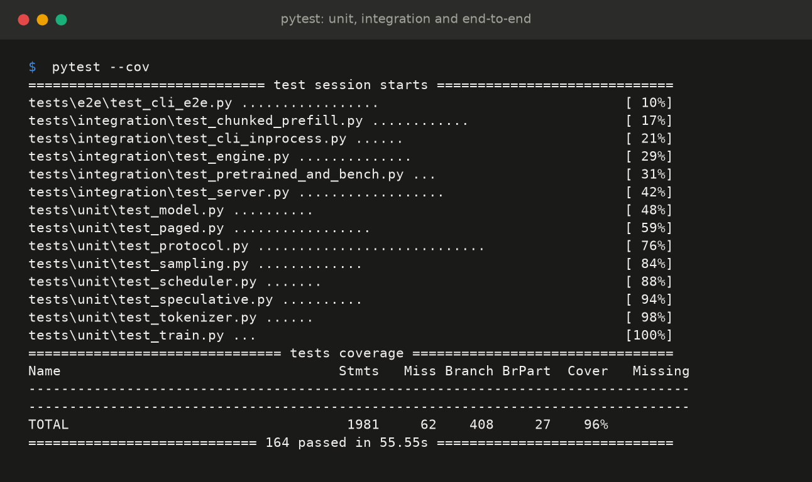

**The server: a blocking completion, an SSE stream, and live metrics**

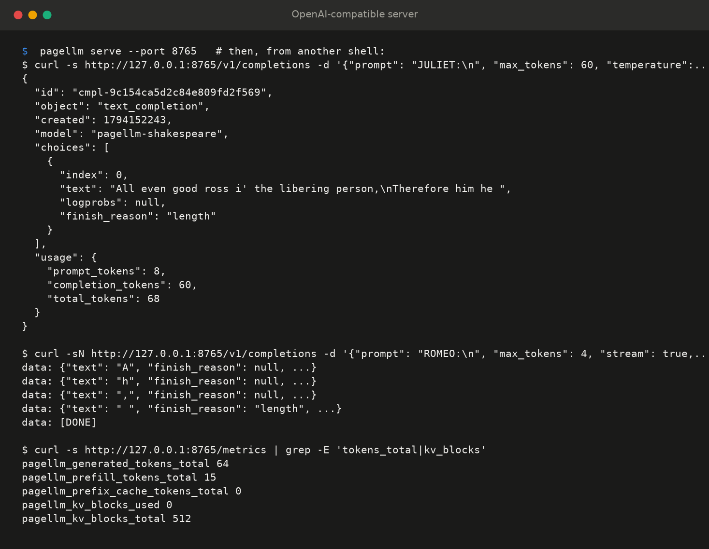

**A load test against a chunked-prefill server (a separate live run)**

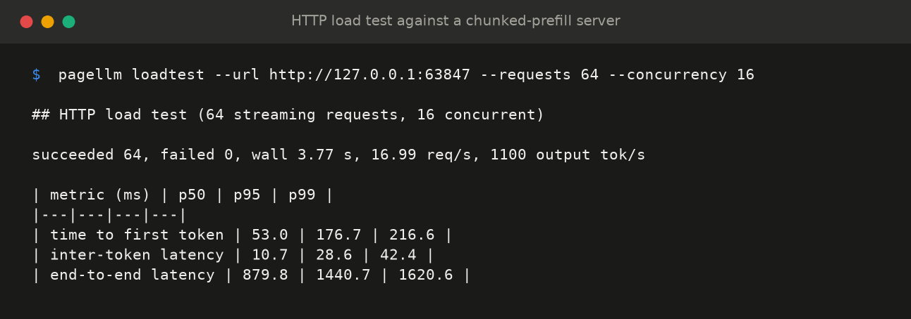

**Generation from the bundled 0.76M-parameter model**

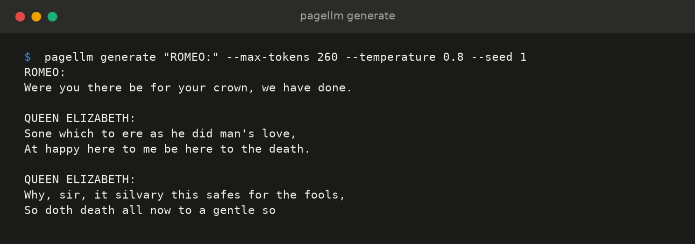

**Paged KV cache walkthrough: shared prefix blocks (refcount 2), a fork (refcount 3), copy-on-write**

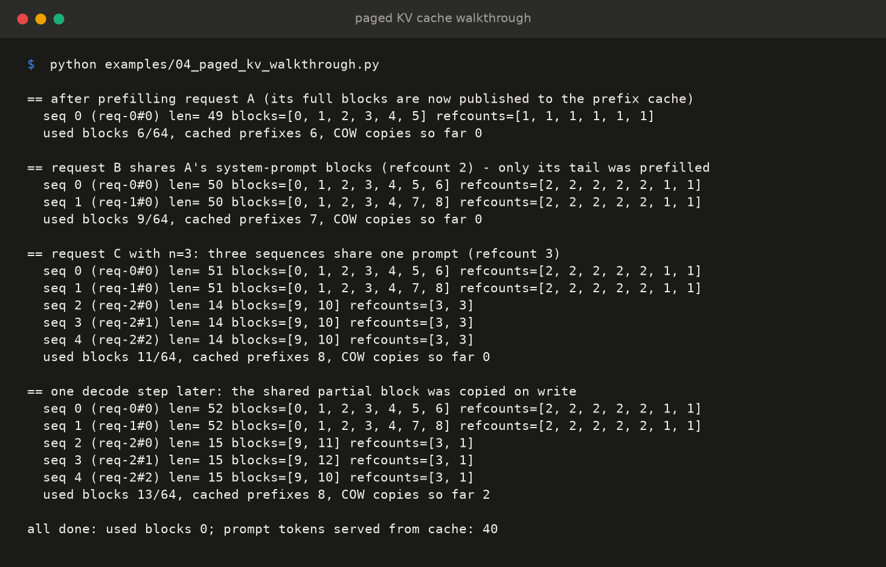

## Architecture

The full set of diagrams (request lifecycle, engine step, scheduler decisions, sequence states, KV block lifecycle, paged memory layout, speculative decoding, package structure) is in **[docs/architecture.md](docs/architecture.md)**.

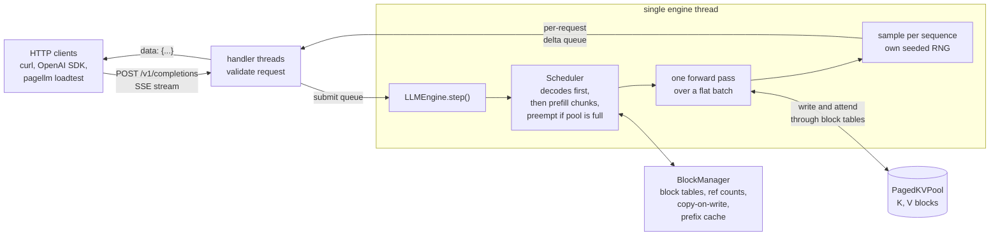

**One engine step is one forward pass over a flat batch.** Rows from every scheduled sequence are concatenated, so a 64-token prompt chunk and fifteen 1-token decodes share the same matmuls. The model never sees the cache layout: it hands each layer's q, k and v to a `KVBackend` (`NoCache`, `ContiguousBatch` or `PagedBatch`). That is the same seam vLLM draws between the model and its cache engine.

**Prefill, decode, chunking and recompute are one code path.** A sequence's uncomputed tokens are always `tokens[num_computed:]`, and each step it computes `num_scheduled` of them. A new request schedules its prompt (minus prefix-cache hits, possibly in chunks), a running one schedules exactly one token, and a preempted one schedules its prompt plus output again.

**One thread owns the engine.** HTTP handler threads never touch it. They validate, enqueue and wait on a per-request queue. A client that disconnects mid-stream is aborted and its blocks are freed. If a step ever raises, in-flight requests get a 500, their blocks are reclaimed, and the server keeps serving.

## Benchmarks

Measured with `pagellm bench all` on a Windows 11 laptop (Intel Core, 8 logical CPUs, Python 3.11.4, numpy 2.4.6), on battery with other applications open. Rerun `make bench` to get your own numbers and charts. Wall-clock results move between runs on a busy laptop, so **the hardware-independent columns (engine steps, KV slots, tokens per forward, acceptance rate) are the ones that carry over exactly.**

BLAS runs single-threaded by default ([ADR 0011](docs/adr/0011-single-threaded-blas.md)): for this model's small matrices, waking OpenBLAS's thread pool cost more than the math, up to 9.5x on an 80-row matmul. Fixing that made every wall-clock number below both faster and stable.

### Continuous vs static batching

128 requests with Poisson arrivals at 400 req/s, prompts of 16 to 96 characters, output lengths log-uniform from 8 to 160 tokens, at most 16 concurrent sequences, greedy. Arrivals follow the seeded trace in simulated time, and the clock advances by the measured wall time of each engine step.

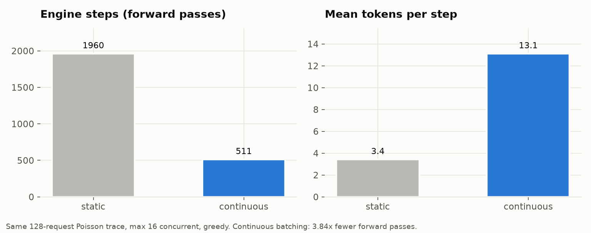

| Policy | Engine steps | Mean tokens per step | Throughput (tok/s) | Mean TTFT (s) | Mean latency (s) | p99 latency (s) |
|---|---|---|---|---|---|---|
| static | 1960 | 3.4 | 1322 | 2.40 | 2.53 | 4.63 |
| continuous | **511** | **13.1** | **1601** | **1.68** | **2.16** | **3.81** |

Continuous batching produced the same tokens in **3.84x fewer forward passes**, for **1.21x throughput**, a **1.42x faster first token** and **1.21x lower p99 latency**. Under static batching a batch keeps running with 1 to 3 live sequences while its longest member finishes, and new arrivals wait. The static baseline is generous: it uses the same flat, unpadded batches, whereas real static servers pad to the longest sequence.

### Chunked prefill

96 requests whose prompts are 96 to 224 tokens long, arriving at 200 req/s while others decode, at most 16 concurrent.

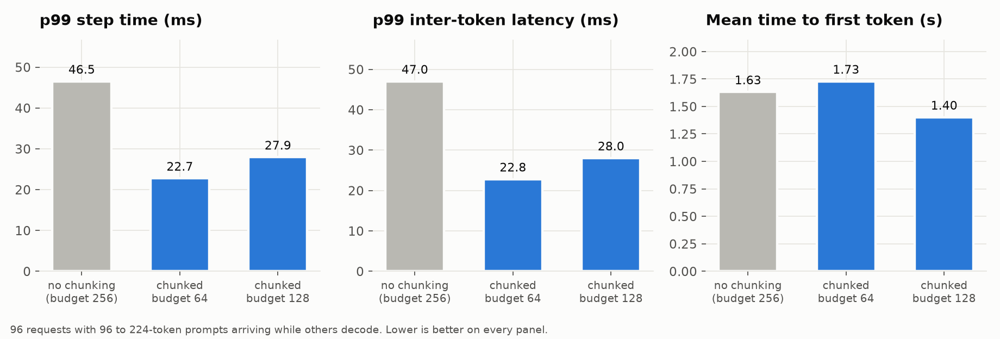

| Config | p99 step (ms) | Mean ITL (ms) | p99 ITL (ms) | Max ITL (ms) | Mean TTFT (s) | Throughput (tok/s) |
|---|---|---|---|---|---|---|
| no chunking (budget 256) | 46.5 | 15.4 | 47.0 | 58.0 | 1.63 | 958 |
| chunked, budget 64 | **22.7** | **12.6** | **22.8** | **25.3** | 1.73 | 986 |
| chunked, budget 128 | 27.9 | 13.2 | 28.0 | 53.8 | **1.40** | **1107** |

Without chunking, a long prompt lands in a single step and every streaming request waits for it. Chunking caps each step at the token budget and schedules decodes before prefill chunks ([ADR 0010](docs/adr/0010-chunked-prefill.md)). The 64-token budget **halves p99 inter-token latency (2.06x)** and cuts the worst stall 2.29x, with slightly higher throughput. The 128-token budget trades some of that smoothness for **15.5% more throughput** and a faster first token. The budget is the knob between the two.

### Chunked prefill over real HTTP

`pagellm bench http` launches `pagellm serve` as a subprocess (chunked prefill off, then on with a 64-token budget) and drives it with `pagellm loadtest`: 64 streaming requests from 16 concurrent clients, prompts of 32 to 128 tokens, 32 to 96 output tokens, T = 0.8.

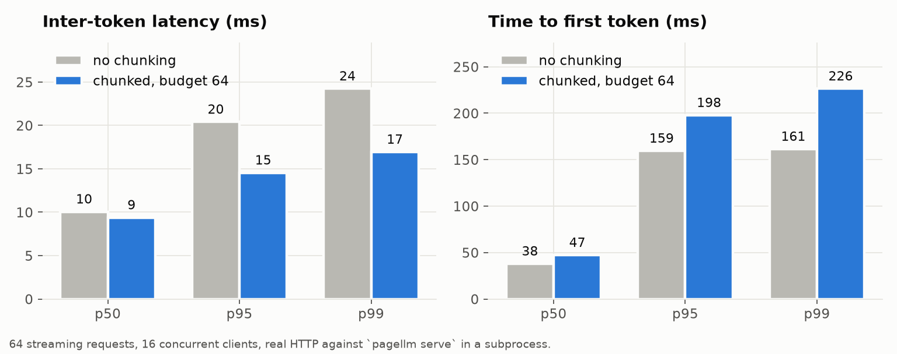

| Server | Output tok/s | TTFT p50 / p99 (ms) | ITL p50 / p95 / p99 (ms) | End-to-end p50 / p99 (ms) |
|---|---|---|---|---|
| no chunking | 1329 | 37.9 / **161.4** | 10.1 / 20.4 / 24.2 | 765.6 / 1271.0 |
| chunked, budget 64 | **1443** | 47.2 / 226.3 | **9.4 / 14.5 / 16.9** | **681.2 / 1133.8** |

Over the full stack, chunked prefill gives **30% lower p99 inter-token latency**, **8.6% more throughput** and **11% lower p99 end-to-end latency**. The cost is a later first token at the tail (p99 TTFT 161 ms to 226 ms), because a long prompt's prefill is spread over several steps. That trade is the reason chunking is a flag and not hard-wired.

### Decode cost vs batch size

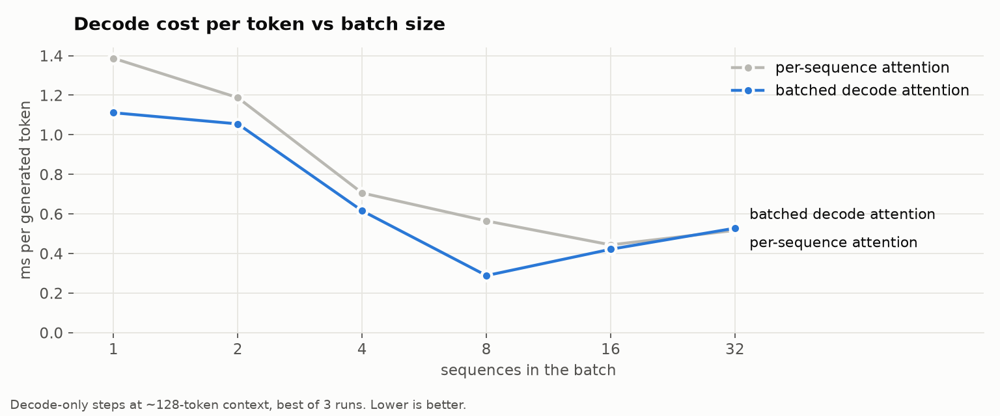

| Batch | Per-sequence attention (ms/token) | Batched decode attention (ms/token) | Speedup |
|---|---|---|---|
| 1 | 1.39 | 1.11 | 1.25x |
| 2 | 1.19 | 1.06 | 1.13x |
| 4 | 0.71 | 0.62 | 1.15x |
| 8 | 0.56 | **0.29** | **1.96x** |
| 16 | 0.44 | 0.42 | 1.05x |
| 32 | 0.52 | 0.53 | 0.98x |

Cost per generated token falls **3.86x** from batch 1 to batch 8. This is the curve continuous batching lives on. Batching all decode rows into one padded attention call helps most around batch 8; at 16 and 32 the remaining cost is the dense matmuls, which both paths share, so the two lines meet. Two fixes produced this curve, both recorded in [ADR 0009](docs/adr/0009-batched-decode-attention.md):

1. Decode attention used to run as a Python loop, one call per sequence per layer. It now runs as one padded, masked matmul for all decoding sequences.
2. `x * (1.0 / np.sqrt(d))` silently promoted float32 attention scores to float64 under NumPy 2 rules, so the next matmul fell off BLAS. Switching to `math.sqrt` made that matmul **43x faster**.

### KV cache memory: contiguous reservation vs paged

The batching trace through the paged engine, with a pool of 256 blocks of 16 slots (4096 token slots) and `max_model_len` 256. At every step the slots held by paged allocation are compared with what reserving `max_model_len` per running sequence would hold.

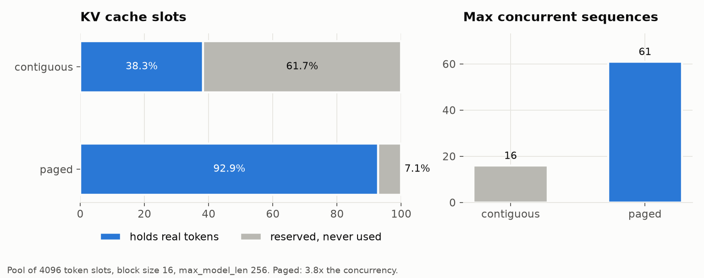

| Scheme | Slots holding real tokens | Wasted | Max concurrent sequences |
|---|---|---|---|
| contiguous (reserve `max_model_len`) | 38.3% | 61.7% | 16 |
| paged | **92.9%** | **7.1%** | **61** (measured) |

The remaining 7% is the half-empty last block of each sequence. Grouped-query attention (2 KV heads for 4 query heads) halves the cache again, to 2048 bytes per token.

### Prefix caching

32 requests that share a 192-character system prompt plus a short user turn, 16 output tokens each.

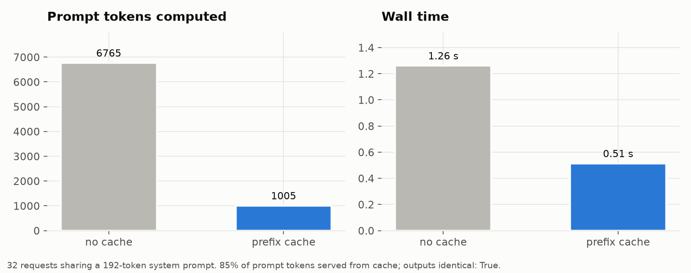

| | Prompt tokens computed | Served from cache | Wall time |
|---|---|---|---|
| no prefix cache | 6765 | 0 | 1.26 s |
| prefix cache | **1005** | **5760 (85%)** | **0.51 s** |

**2.46x faster**, and the greedy outputs are byte-identical with and without the cache.

### Speculative decoding

Target: 0.76M parameters, 4 layers. Draft: 0.055M parameters, 1 layer. 6 prompts, 160 tokens each.

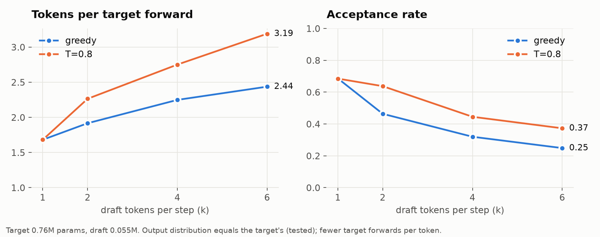

| Sampling | k | Acceptance rate | Tokens per target forward | Wall speedup |
|---|---|---|---|---|
| greedy | 1 | 0.69 | 1.68 | 1.24x |
| greedy | 2 | 0.46 | 1.92 | **1.30x** |
| greedy | 4 | 0.32 | 2.25 | 1.20x |
| greedy | 6 | 0.25 | 2.44 | 0.79x |
| T = 0.8 | 1 | 0.68 | 1.68 | 0.85x |
| T = 0.8 | 2 | 0.64 | 2.26 | **1.47x** |
| T = 0.8 | 4 | 0.45 | 2.75 | 1.31x |
| T = 0.8 | 6 | 0.37 | **3.19** | 0.94x |

Measured forward costs: target with 1 token 1158 us, target with 5 tokens 1808 us, draft with 1 token 444 us.

Speculation delivers up to 3.19 tokens per target forward and up to 1.47x in wall time. The speedup is roughly `tokens_per_forward / (k * c_draft / c_target + c_verify / c_target)`. Here the draft costs 0.38 of a target forward, so past k = 4 the drafts cost more than they save, which is exactly where the measured speedup turns down. Real deployments get 2x to 3x because their draft is 10x to 100x cheaper than a large, memory-bound target. The tests check that speculation never changes the output distribution.

## Testing

```bash
pytest                       # everything (164 tests)
pytest tests/unit            # pure logic, milliseconds each
pytest tests/integration     # engine, chunked prefill, in-process server, CLI entry points
pytest tests/e2e -v          # real CLI in a subprocess, real weights, real HTTP
make cov                     # coverage report (96% line coverage)
```

| Tier | What it covers |
|---|---|
| **unit** | attention vs a textbook reference, RoPE relativity, paged vs contiguous attention on scattered blocks, batched decode attention, allocator ref counts and double-free detection, copy-on-write, prefix hashing, scheduler policy (FCFS, budget, preemption), sampling distributions, the speculative acceptance law (statistical), backward pass vs finite differences, 24 malformed request bodies, BLAS thread pinning |
| **integration** | engine output equals uncached greedy decoding; batched equals single; preemption preserves sampled outputs and leaks no blocks; chunked prefill gives identical outputs for budgets from 1 to 48 tokens and never stalls a running decode; stop strings while streaming; in-process server: SSE equals blocking, concurrent clients, client disconnect frees blocks, an injected engine fault returns 500 and recovers, `/metrics`, the load tester against a chunked server; CLI, training and every benchmark in quick mode |
| **end-to-end** | launches `python -m pagellm serve` as a real subprocess and talks HTTP only: deterministic seeded completions, SSE stream equal to blocking, 16 concurrent clients, metrics after traffic (zero leaked KV blocks), `--chunked-prefill`, `pagellm loadtest`, malformed input over the wire; runs `generate`, `--speculative`, `-n`, `bench --json` and all four examples |

Regression tests pin the bugs fixed in this codebase: a non-integer `seed` that crashed the engine thread, unbounded memory growth in engine statistics, the float64 promotion in attention, and the BLAS threading default.

## CI/CD

| Workflow | Trigger | Jobs |
|---|---|---|
| [`ci.yml`](.github/workflows/ci.yml) | push, pull request | ruff lint, ruff format, mypy; tests on Linux, macOS and Windows with Python 3.11, 3.12 and 3.13 (coverage gate 90%); end-to-end on Linux and Windows; build the wheel and smoke-test it in a clean venv; build the Docker image and query the running container |
| [`benchmarks.yml`](.github/workflows/benchmarks.yml) | weekly, manual, PRs touching the engine | runs the benchmarks, renders charts, posts the tables to the job summary, uploads JSON and PNGs |
| [`release.yml`](.github/workflows/release.yml) | tag `v*.*.*` | full test suite, tag and version check, build, GitHub release with wheel and sdist |
| [`codeql.yml`](.github/workflows/codeql.yml) | push, pull request, weekly | CodeQL security and quality analysis |
| [`dependabot.yml`](.github/dependabot.yml) | weekly | pip and GitHub Actions updates |

## Design decisions

Each decision is recorded as an ADR in [`docs/adr`](docs/adr/README.md).

| ADR | Decision | The trade-off in one line |
|---|---|---|
| [0001](docs/adr/0001-numpy-only-runtime.md) | numpy-only runtime | readable and testable everywhere; absolute speed is low |
| [0002](docs/adr/0002-paged-kv-cache.md) | paged KV cache with ref counts | 7% waste instead of 62%; reads go through an indirection |
| [0003](docs/adr/0003-recompute-preemption.md) | recompute, not swap | no CPU tier to manage; long sequences pay a re-prefill |
| [0004](docs/adr/0004-single-engine-thread.md) | one engine thread behind queues | no locks; the loop is defended as a single point of failure |
| [0005](docs/adr/0005-prefix-cache-hashing.md) | chained SHA-256 block hashes | no silent wrong hits; one hash per full block |
| [0006](docs/adr/0006-lossless-speculative-decoding.md) | accept on the processed distribution | exact under any sampling settings; single-sequence only |
| [0007](docs/adr/0007-stdlib-http-server.md) | stdlib HTTP with strict validation | zero dependencies; TLS and auth belong to a proxy |
| [0008](docs/adr/0008-fcfs-admission.md) | FCFS without skip-ahead | no starvation; slightly lower throughput |
| [0009](docs/adr/0009-batched-decode-attention.md) | batched decode attention, float32 discipline | cheaper decode tokens; padding wastes some compute |
| [0010](docs/adr/0010-chunked-prefill.md) | chunked prefill, decode-first | half the p99 stall; long prompts start a little later |
| [0011](docs/adr/0011-single-threaded-blas.md) | single-threaded BLAS by default | fast, stable small matmuls; big models should raise it |

## Project layout

```
src/pagellm/
  model/          transformer.py (Llama-style decoder, KVBackend), tokenizer.py, weights.py
  cache/          contiguous.py (per-sequence cache), paged.py (allocator, block tables,
                  copy-on-write, prefix cache, paged and batched attention)
  scheduling/     scheduler.py (continuous and static batching, chunked prefill, preemption)
  engine/         llm_engine.py (the step loop), sampling.py, speculative.py
  serving/        protocol.py (validation), server.py (HTTP + SSE), metrics.py (Prometheus)
  training/       trainer.py (numpy training with a hand-derived backward pass)
  benchmarks/     runner.py (every benchmark in this README), loadtest.py (HTTP load tester)
  weights/        bundled target.npz and draft.npz
  cli.py          pagellm {generate, serve, bench, loadtest, train}
tests/            unit/, integration/, e2e/
examples/         offline batch, SSE client, speculative decoding, paged KV walkthrough
scripts/          make_figures.py (charts), make_screenshots.py (terminal captures)
docs/             adr/, results/ (benchmark JSON and tables), assets/ (images)
```

## Limitations and roadmap

**Limitations**

- CPU and numpy, so absolute speed is small. A step is dominated by Python and per-call overhead, not FLOPs.
- One engine thread and no tensor or pipeline parallelism; prefill and decode share the GIL with HTTP handling.
- Speculative decoding runs on one sequence with contiguous caches; it is not wired into the batched engine.
- Character-level tokenizer and a 0.76M-parameter model: the text is Shakespeare-flavoured, not coherent. `logprobs` and `echo` are not implemented.
- The BLAS thread setting only applies if `pagellm` is imported before numpy.
- No TLS, authentication or rate limiting. Run it behind a reverse proxy.

**Roadmap**

- [x] Chunked prefill with decode-first scheduling
- [x] HTTP load tester with latency percentiles
- [ ] Speculative decoding inside the batched engine (per-sequence k, paged rollback)
- [ ] Swap-based preemption with a CPU block pool and a swap-or-recompute cost model
- [ ] `logprobs`, `echo` and `/v1/chat/completions`
- [ ] Priority and SLO-aware admission
- [ ] A BPE tokenizer with incremental UTF-8-safe detokenization
- [ ] Draft-free speculation (Medusa or lookahead style)

## References

- Kwon et al., *Efficient Memory Management for Large Language Model Serving with PagedAttention*, SOSP 2023.
- Yu et al., *Orca: A Distributed Serving System for Transformer-Based Generative Models*, OSDI 2022.
- Agrawal et al., *Taming Throughput-Latency Tradeoff in LLM Inference with Sarathi-Serve*, OSDI 2024.
- Leviathan, Kalman and Matias, *Fast Inference from Transformers via Speculative Decoding*, ICML 2023.
- Chen et al., *Accelerating Large Language Model Decoding with Speculative Sampling*, 2023.
- Su et al., *RoFormer: Enhanced Transformer with Rotary Position Embedding*, 2021.
- Ainslie et al., *GQA: Training Generalized Multi-Query Transformer Models from Multi-Head Checkpoints*, 2023.

## License

MIT. See [LICENSE](LICENSE).
