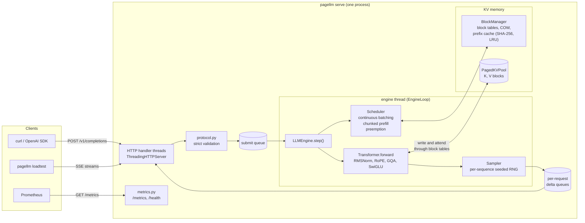
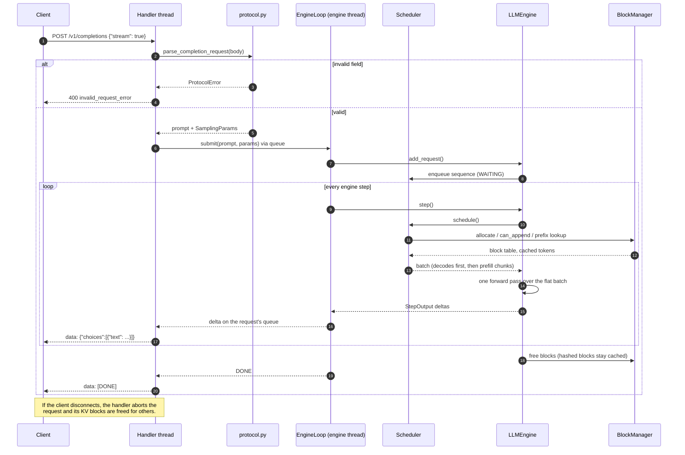
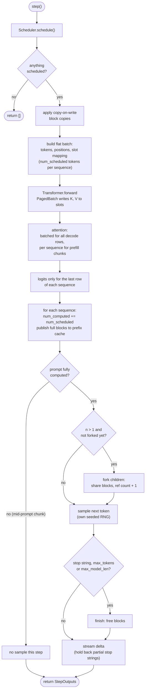
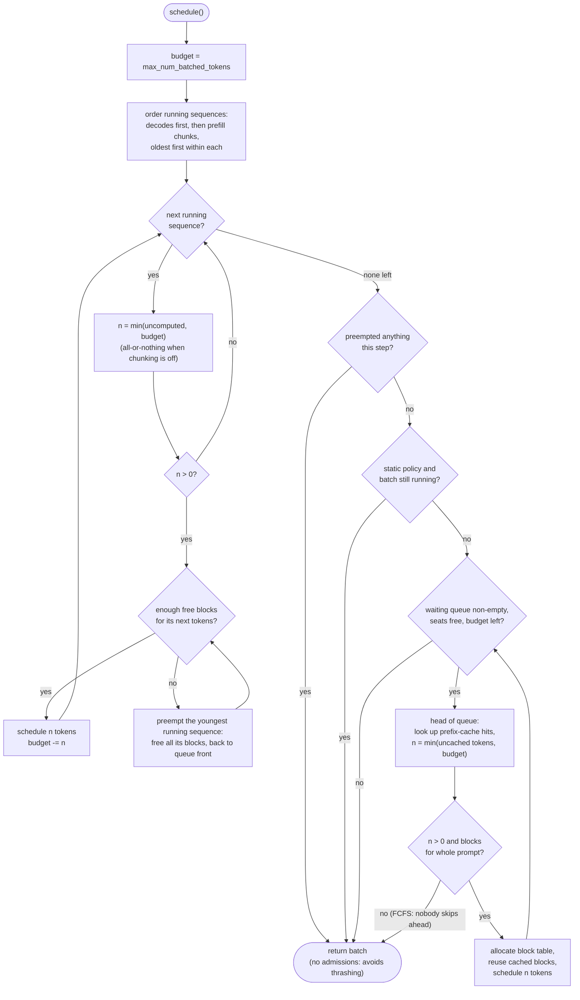
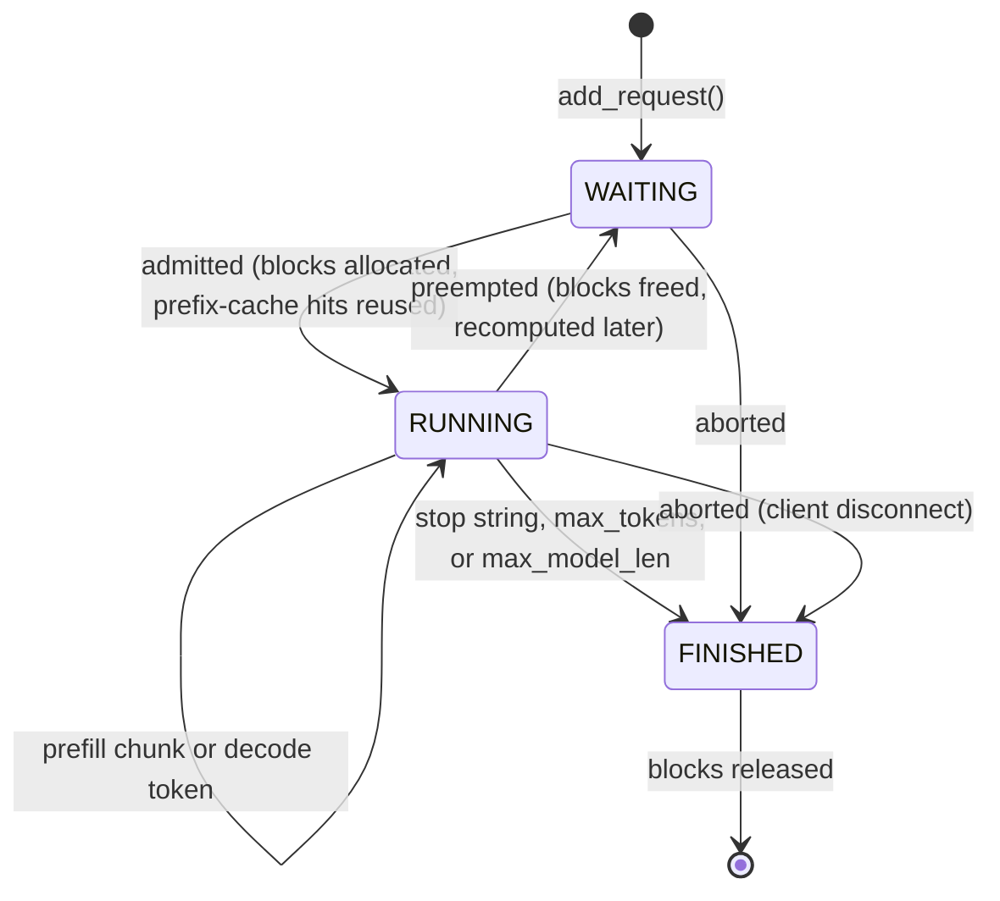
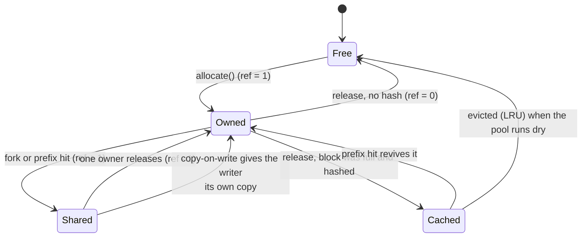
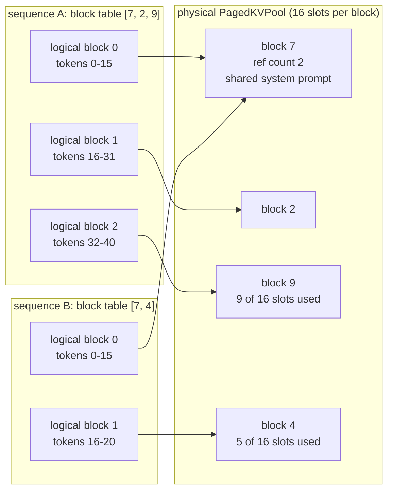
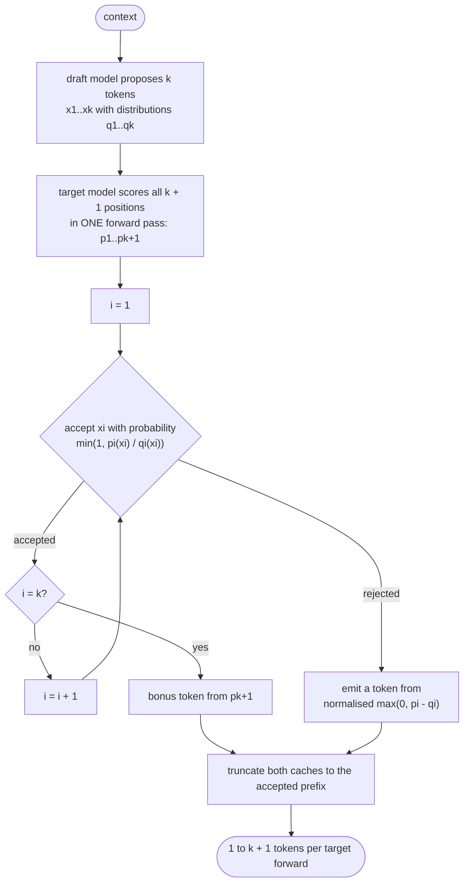
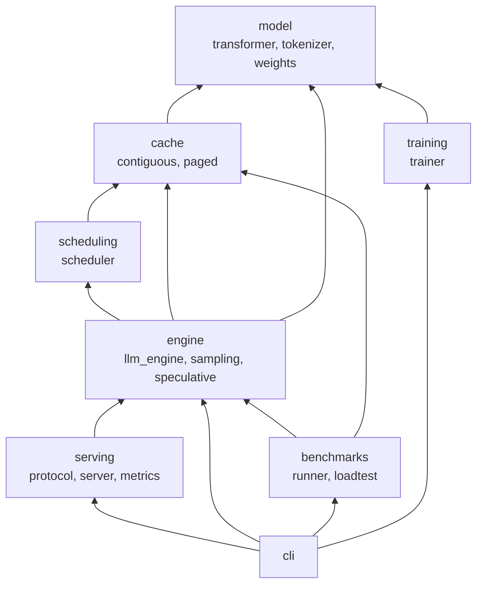

# Architecture

This document shows how pagellm is put together and how a request flows through it. Every diagram is Mermaid, so GitHub renders it in place. The design decisions behind each part are recorded in the [ADRs](adr/README.md).

- [1. System overview](#1-system-overview)
- [2. Request lifecycle](#2-request-lifecycle)
- [3. One engine step](#3-one-engine-step)
- [4. Scheduler decisions](#4-scheduler-decisions)
- [5. Sequence states](#5-sequence-states)
- [6. KV block lifecycle](#6-kv-block-lifecycle)
- [7. Paged memory layout](#7-paged-memory-layout)
- [8. Speculative decoding](#8-speculative-decoding)
- [9. Package structure](#9-package-structure)

## 1. System overview

HTTP handler threads never touch the engine. They validate a request, hand it to the single engine thread through a queue, and wait on a per-request queue of output deltas ([ADR 0004](adr/0004-single-engine-thread.md)).

## 2. Request lifecycle

A streaming completion from the first byte to `[DONE]`. A blocking request follows the same path; the handler simply collects every delta before replying.

## 3. One engine step

One step is exactly one forward pass. Prompt chunks and single-token decodes from many sequences are concatenated into one flat batch, so they share every matmul.

## 4. Scheduler decisions

Running sequences are served first, decodes before prefill chunks, oldest first. New requests are admitted strictly first come, first served, and never in a step that had to preempt ([ADR 0003](adr/0003-recompute-preemption.md), [ADR 0008](adr/0008-fcfs-admission.md), [ADR 0010](adr/0010-chunked-prefill.md)).

## 5. Sequence states

## 6. KV block lifecycle

Blocks are reference counted. A freed block that carries a prefix hash is not wiped: it stays in an LRU set and can be revived by a later request with the same prefix ([ADR 0002](adr/0002-paged-kv-cache.md), [ADR 0005](adr/0005-prefix-cache-hashing.md)).

## 7. Paged memory layout

Each sequence sees a contiguous logical KV cache. Physically its tokens live in fixed-size blocks anywhere in the pool, found through its block table. Two requests that share a system prompt point at the same physical blocks.

Waste is bounded by one partly filled block per sequence, instead of the whole unused tail that a contiguous `max_model_len` reservation holds.

## 8. Speculative decoding

A cheap draft proposes k tokens; the target scores all of them in one forward pass. The acceptance rule makes the output distribution exactly the target's ([ADR 0006](adr/0006-lossless-speculative-decoding.md)).

## 9. Package structure

Arrows point from a package to the packages it imports. The model knows nothing about caches or scheduling: it only talks to the `KVBackend` interface.

| Package | Responsibility | Key types |
|---|---|---|
| `model` | the network and its weights | `Transformer`, `ModelConfig`, `KVBackend`, `CharTokenizer` |
| `cache` | where K and V live, and how attention reads them | `PagedKVPool`, `BlockManager`, `BlockAllocator`, `PagedBatch`, `KVCache` |
| `scheduling` | which sequences run each step, and how many tokens each | `Scheduler`, `Sequence`, `ScheduledBatch` |
| `engine` | the step loop, sampling, speculative decoding | `LLMEngine`, `SamplingParams`, `SpeculativeDecoder` |
| `serving` | HTTP, SSE, validation, metrics | `Server`, `EngineLoop`, `parse_completion_request` |
| `training` | numpy training with a hand-derived backward pass | `train`, `loss_and_grads`, `AdamW` |
| `benchmarks` | every measured number in the README | `run_trace`, `run_load` |
